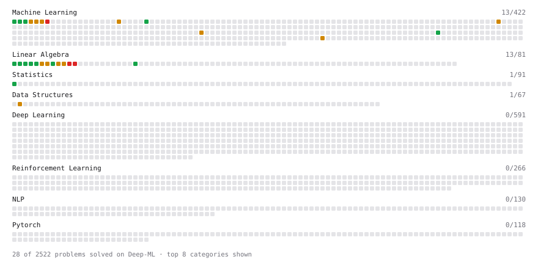

# Deep-ML

My machine learning practice from [Deep-ML](https://www.deep-ml.com). Every solution here was written by hand.

**43** solved · 30 problems · 2 labs · 11 math

[**Browse the interactive portfolio**](https://perryzhu-lab.github.io/deep-ml/) to replay this filling in over time.

## Problems

| | Difficulty | Solved | |
| --- | --- | --- | --- |
| [Calculate 2x2 Matrix Inverse](https://www.deep-ml.com/problems/8) | easy | 2026-10-28 | [solution](problems/0008-calculate-2x2-matrix-inverse) |
| [Calculate Covariance Matrix](https://www.deep-ml.com/problems/10) | easy | 2026-10-28 | [solution](problems/0010-calculate-covariance-matrix) |
| [Calculate Mean by Row or Column](https://www.deep-ml.com/problems/4) | easy | 2026-10-28 | [solution](problems/0004-calculate-mean-by-row-or-column) |
| [Calculate R-squared for Regression Analysis](https://www.deep-ml.com/problems/69) | easy | 2026-11-24 | [solution](problems/0069-calculate-r-squared-for-regression-analysis) |
| [Calculate Root Mean Square Error (RMSE)](https://www.deep-ml.com/problems/71) | easy | 2026-11-24 | [solution](problems/0071-calculate-root-mean-square-error-rmse) |
| [Detect Overfitting or Underfitting](https://www.deep-ml.com/problems/86) | easy | 2026-11-24 | [solution](problems/0086-detect-overfitting-or-underfitting) |
| [Feature Scaling Implementation](https://www.deep-ml.com/problems/16) | easy | 2026-10-31 | [solution](problems/0016-feature-scaling-implementation) |
| [Implement Orthogonal Projection of a Vector onto a Line](https://www.deep-ml.com/problems/66) | easy | 2026-11-07 | [solution](problems/0066-implement-orthogonal-projection-of-a-vector-onto-a-line) |
| [Linear Regression Using Gradient Descent](https://www.deep-ml.com/problems/15) | easy | 2026-10-30 | [solution](problems/0015-linear-regression-using-gradient-descent) |
| [Linear Regression Using Normal Equation](https://www.deep-ml.com/problems/14) | easy | 2026-10-30 | [solution](problems/0014-linear-regression-using-normal-equation) |
| [Matrix-Vector Dot Product](https://www.deep-ml.com/problems/1) | easy | 2026-10-21 | [solution](problems/0001-matrix-vector-dot-product) |
| [Random Train/Validation/Test Split with Shuffling](https://www.deep-ml.com/problems/1058) | easy | 2026-11-23 | [solution](problems/1058-random-train-validation-test-split-with-shuffling) |
| [Reshape Matrix](https://www.deep-ml.com/problems/3) | easy | 2026-10-27 | [solution](problems/0003-reshape-matrix) |
| [Scalar Multiplication of a Matrix](https://www.deep-ml.com/problems/5) | easy | 2026-10-28 | [solution](problems/0005-scalar-multiplication-of-a-matrix) |
| [Transpose of a Matrix](https://www.deep-ml.com/problems/2) | easy | 2026-10-22 | [solution](problems/0002-transpose-of-a-matrix) |
| [Bayesian Linear Regression: Sequential Posterior and Predictive Bands](https://www.deep-ml.com/problems/1817) | medium | 2026-11-10 | [solution](problems/1817-bayesian-linear-regression-sequential-posterior-and-predictive-bands) |
| [Calculate Eigenvalues of a Matrix](https://www.deep-ml.com/problems/6) | medium | 2026-10-28 | [solution](problems/0006-calculate-eigenvalues-of-a-matrix) |
| [Handle Missing Data with Imputation](https://www.deep-ml.com/problems/354) | medium | 2026-11-23 | [solution](problems/0354-handle-missing-data-with-imputation) |
| [Implement Gradient Descent Variants with MSE Loss](https://www.deep-ml.com/problems/47) | medium | 2026-11-08 | [solution](problems/0047-implement-gradient-descent-variants-with-mse-loss) |
| [Implement K-Fold Cross-Validation](https://www.deep-ml.com/problems/18) | medium | 2026-11-01 | [solution](problems/0018-implement-k-fold-cross-validation) |
| [K-Means Clustering](https://www.deep-ml.com/problems/17) | medium | 2026-10-31 | [solution](problems/0017-k-means-clustering) |
| [Matrix times Matrix ](https://www.deep-ml.com/problems/9) | medium | 2026-10-28 | [solution](problems/0009-matrix-times-matrix) |
| [Matrix Transformation ](https://www.deep-ml.com/problems/7) | medium | 2026-10-28 | [solution](problems/0007-matrix-transformation) |
| [Numerical Gradient Checking](https://www.deep-ml.com/problems/313) | medium | 2026-11-09 | [solution](problems/0313-numerical-gradient-checking) |
| [Principal Component Analysis (PCA) Implementation](https://www.deep-ml.com/problems/19) | medium | 2026-11-01 | [solution](problems/0019-principal-component-analysis-pca-implementation) |
| [Solve Linear Equations using Jacobi Method](https://www.deep-ml.com/problems/11) | medium | 2026-10-29 | [solution](problems/0011-solve-linear-equations-using-jacobi-method) |
| [StandardScaler Fit and Transform](https://www.deep-ml.com/problems/842) | medium | 2026-11-23 | [solution](problems/0842-standardscaler-fit-and-transform) |
| [Decision Tree Learning](https://www.deep-ml.com/problems/20) | hard | 2026-11-04 | [solution](problems/0020-decision-tree-learning) |
| [Determinant of a 4x4 Matrix using Laplace's Expansion (hard)](https://www.deep-ml.com/problems/13) | hard | 2026-10-30 | [solution](problems/0013-determinant-of-a-4x4-matrix-using-laplace-s-expansion-hard) |
| [Singular Value Decomposition (SVD) of 2x2 Matrix](https://www.deep-ml.com/problems/12) | hard | 2026-10-30 | [solution](problems/0012-singular-value-decomposition-svd-of-2x2-matrix) |

## Labs

| | Difficulty | Solved | |
| --- | --- | --- | --- |
| [Split the Data Honestly and Beat a Baseline](https://www.deep-ml.com/labs/3d26c3f9-cb73-4ab1-bc4d-86cfab2af6d1) | easy | 2026-11-23 | [solution](labs/3d26c3f9-cb73-4ab1-bc4d-86cfab2af6d1-split-the-data-honestly-and-beat-a-baseline) |
| [Train a Linear Regression Model](https://www.deep-ml.com/labs/18) | easy | 2026-11-21 | [solution](labs/0018-train-a-linear-regression-model) |

## Math

| | Difficulty | Solved | |
| --- | --- | --- | --- |
| [Derivatives and Gradients](https://www.deep-ml.com/math-problems/1) | easy | 2026-11-08 | [solution](math/0001-derivatives-and-gradients) |
| [Gradient Descent Updates](https://www.deep-ml.com/math-problems/5) | easy | 2026-11-08 | [solution](math/0005-gradient-descent-updates) |
| [Matrix Basics](https://www.deep-ml.com/math-problems/9) | easy | 2026-10-21 | [solution](math/0009-matrix-basics) |
| [ML Workflow Basics](https://www.deep-ml.com/math-problems/30) | easy | 2026-11-23 | [solution](math/0030-ml-workflow-basics) |
| [Vector Operations](https://www.deep-ml.com/math-problems/7) | easy | 2026-10-21 | [solution](math/0007-vector-operations) |
| [Bayesian Linear Regression: Posterior and Posterior Predictive](https://www.deep-ml.com/math-problems/454) | medium | 2026-11-09 | [solution](math/0454-bayesian-linear-regression-posterior-and-posterior-predictive) |
| [Inverse and Rank](https://www.deep-ml.com/math-problems/12) | medium | 2026-11-07 | [solution](math/0012-inverse-and-rank) |
| [Least Squares and the Normal Equations](https://www.deep-ml.com/math-problems/34) | medium | 2026-11-07 | [solution](math/0034-least-squares-and-the-normal-equations) |
| [Matrix Multiplication](https://www.deep-ml.com/math-problems/10) | medium | 2026-11-06 | [solution](math/0010-matrix-multiplication) |
| [Orthogonality and Projections](https://www.deep-ml.com/math-problems/14) | medium | 2026-11-07 | [solution](math/0014-orthogonality-and-projections) |
| [Training Error, Test Error and the Bayes Rate](https://www.deep-ml.com/math-problems/104) | medium | 2026-11-24 | [solution](math/0104-training-error-test-error-and-the-bayes-rate) |

---

_This file is regenerated by Deep-ML on every push._
